# SWOS Reverse Engineering (RE) Project

## Introduction

I began reverse-engineering the Amiga version of Sensible World of Soccer (SWOS) in August 2025. My goal is to produce a faithful, well-documented understanding of the original game's codebase and data formats so that bugs can be analyzed, features can be studied, and future ports or tooling can build on a solid foundation. Although the target is the Amiga build, this work stands on the shoulders of prior DOS research - most notably Zlatko Karakas (@zlatkok), whose IDA Pro database of the DOS version provided a treasure trove of function/variable names, comments, and structures that I carefully adapted to the Amiga binary.

The workflow blends IDA Pro for disassembly with Ghidra for decompilation. While IDA excels at organizing symbols and navigation, only Ghidra currently offers a practical m68k to C decompiler, so I import the IDA database into Ghidra using the community plugin. To make this round-trip smoother and the output more accurate, I modified that plugin to improve export fidelity and symbol transfer. From there, I rely on a suite of custom Python scripts to lift the overall quality of the decompilation: normalizing calling conventions, taming aggressive casts, teasing apart union-like data access, and annotating engine-specific patterns that recur throughout the code.

Automated decompilation can only take you so far. SWOS - like many performance-tuned 90s games - leans on tight register juggling, overlapping data layouts, and hand-written assembly tricks that don't cleanly map to high-level constructs. After a certain point, manual reconstruction becomes essential: refactoring control flow into meaningful functions, elevating magic numbers into enums and constants, and reconciling ambiguous pointer arithmetic with real engine abstractions.

Looking ahead, I plan to use AI-assisted cleanup to accelerate the most tedious parts of this process - e.g., proposing types for "undefined" temporaries, surfacing likely structure fields, and suggesting clearer function boundaries - while keeping a human in the loop for all correctness and style decisions. The aim isn't to auto-port the game, but to produce readable, reviewable C that reflects the original intent of the Amiga code, informed by DOS symbols where appropriate and verified against observed behavior.

## DOS Version

```
PC version of SWOS was written as a conversion from Amiga. It can be deduced by analyzing the code, and there are even some left over strings such as `INSERT BLANK DISK IN DF0:`. There are 15 memory locations (dwords) that are used as registers. Their start is at 0x3146d. These dwords correspond to Amiga s MC68000 processor registers: data registers D0-D7 and address registers A0-A7

This is not a mistake (15 locations for 16 registers) because register A7 (stack pointer) is mapped directly to Intel's esp register. This means that PC version of SWOS is using so called static emulation, where whole program is translated into host machine language and then executed. Other type of emulation is dynamic emulation, where an interpreter is used that interprets original code run-time (this is the way most emulators operate).

Since SWOS is a commercial game, it was more feasibile to use the first approach. I think they did the following: first Amiga s source code (which I believe was mostly written in assembler, or some optimizing C compiler - somebody correct me if I'm wrong) was converted into C code, probably using some third party utility. Than they rewrited some heavily used routines completely in x86 assembler for speed, and rewrited non-portable routines (file handling, input handling, video) to get fully running x86 executable. Compiler used to put all this together was Watcom C - sw(o)s.exe contains whole Watcom run-time library, both 16 and 32-bit versions.
```
\- @Playaveli

More info about the DOS version [here](https://sensiblesoccer.de/forum/editing-programming/4355-about-swos-programming-knowledge)

### History of `swos-port`

In the early 2000s, Zlatko Karakas and his cousin got hooked on Sensible World of Soccer (SWOS) but hit a snag: no two-player keyboard support. Fresh from learning machine code and taking a compiler course, Zlatko reverse-engineered the input routines and hacked in two-player keyboard play. Hex editing soon hit its limits, so in 2004 he created SWOS++ - a tiny loader patched into the game that brings in a separate SWOS++ binary at runtime (DLL-style). That worked well until DOS constraints capped progress, leading to `swos-port`, a cross-platform re-creation.

The workflow evolved from raw hex patches to NASM/MASM x86 assembly with advanced macros, then gradually to C, and ultimately C++ for growing systems like multiplayer. Zlatko's toolkit included IDA Pro, hex editors, NASM/MASM, Perl scripts, and piles of notes and diagrams. Exploration of SWOS formats also produced SWPE (SWOS Picture Editor). As knowledge accumulated, "static emulation" became feasible - mixing emulated chunks of the original with manually decompiled parts and new code.

Technically, swos-port starts from a full disassembly (one big .asm), converted to C++ with x86 and 68k registers modeled as variables and carefully controlled memory access to preserve original assumptions. Some code is removed or replaced, external variables are introduced, and the generated core is linked with hand-written input, graphics, and other systems. It's a long-running side project pursued in bursts (often between jobs), adding up to several years of effort. A key inspiration for making SWOS++ a proper add-on was Swedish Yankspankers' TA Demo Recorder for Total Annihilation, which showed how powerful reverse-engineered enhancements could be.

## Amiga Version

### Version Info
- Sensible World Of Soccer '96/'97
```
SENSIBLE WORLD OF SOCCER.
Copyright (C) 1994/1995 Sensible Software (6/11/1996).
Copyright (C) 1994/1995 Chris Chapman (6/11/1996) 
SWOS VERSION 152.
(06/11/96 13.55) ASM 6/11/1996
```

### Credits
- **Coder**: Chris Chapman (Chipper)
- **Graphics**:
	- Jonathan Hare (Johnathan Hare, Jovial Jops)
	- Stoo Cambridge (Stuart Cambridge)
- **Audio**:
	- Richard Joseph
	- Jonathan Hare (Johnathan Hare, Jovial Jops)
	- Alex Joseph
	- Graham King
	- Jason Page
	- Jacks Read
- **Audio System**
	- https://www.exotica.org.uk/wiki/Richard_Joseph_(format)
	- Richard Joseph (format) / Vectordean format
	- RJP1
	- `CODED BY ANDI SMITHERS, VECTORDEAN (C) MILLENNIUM 1992`

### TOSEC Files

The adf's used in this project are:

- Sensible World of Soccer 96-97 (1996)(Renegade)[cr HF](Disk 1 of 2).adf
- Sensible World of Soccer 96-97 (1996)(Renegade)[cr HF](Disk 2 of 2).adf

### Useful Tools

- [UAEUNP 0.8](https://www.winuae.net/download/) list and extract Amiga based disk images and archives such as ADF.
- [rnc_lib.exe](https://www.romhacking.net/utilities/1310/) will compress or decompress an RNC compressed file.
- [SWOEditorS](https://swoes.info/editor_downloads/) an editor for Sensible world of soccer

### Memory Regions

| Section Name  | Start Address | Length    | Permissions |
|---------------|---------------|-----------|-------------|
| CHIP_RAM      | `0x000000`    | `0x200000`| `rwx`       |
| CIAB          | `0xBFD000`    | `0x1000`  | `rw`        |
| CIAA          | `0xBFE000`    | `0x1000`  | `rw`        |
| AMIGA_CUSTOM  | `0xDFF000`    | `0x200`   | `rw`        |
| KICK_ROM      | `0xF80000`    | `0x80000` | `rx`        |

This is a **memory map** for an Amiga system showing key address ranges and how they can be used:

- **CHIP_RAM**: Main shared RAM the CPU and custom chips (Agnus/Denise/Paula) can access - for code, data, and graphics/audio buffers.
- **CIAB** and **CIAA (`0xBFE000`–`0xBFEFFF`, 4 KB, `rw`)**: The two Complex Interface Adapters - memory-mapped I/O registers for timers, keyboard/joystick, serial/parallel, etc.
- **AMIGA_CUSTOM**: Custom-chip register block (blitter, copper, bitplanes, audio, sprites, interrupts).    
- **KICK_ROM**: The Kickstart ROM with the OS core; readable/executable but not writable.

Permissions indicate whether each region is **readable (r)**, **writable (w)**, and/or **executable (x)**.

### IDA Pro 9.0 Setup

NOTE: If you don't have IDA Pro skip to `Ghidra Setup` and use the [SWOS2.xml](SWOS2/SWOS2.xml) file that's already exported from IDA Pro.

### IDA Pro 9.0 Shortcuts

Here are some useful shortcuts:

- `u` undefine
- `y` Enter "C-type"
- `g` Jump to label / address
- `d` Cycle data type
- `n` Edit name
- `:` Edit comment
- `ESC` Jump back to previous location (used ALOT)
- `CTRL-F` Text search
- `CTRL-F1` Local types
- Local Types - View > Open subviews > Local Types (or Shift+F1)
- Place the cursor at the start (001796BC)
	- Cycle using `d`
	- Press * (asterisk) repeatedly to define the rest as an array:
	- Or: Press Alt+F2 and type 256 to define exactly 256 elements
- Edit > Other > Reset decompiler information, then selecting (only) All caches
- Codesegment data directives
	- `db` = define byte (1 B)
	- `dw` = define word (2 B)
	- `dd` = define dword (4 B)
	- `dq` = define qword (8 B)
- Pointer sizes in 16-bit DOS:
	- `Near` (offset-only) = 2 B
	- `Far` (segment:offset) = 4 B

### IDA Pro 9.0 Scripts

#### find_undefined_filebacked.py

[find_undefined_filebacked.py](IDAPro/Scripts/find_undefined_filebacked.py) scans your IDA database for **contiguous ranges of file-backed bytes** (i.e., from the original file, not BSS) that are still **undefined** (no code/data item) and prints each run as `START_ADDRESS len=BYTES` to the Output window; this makes it easy to spot "holes" you need to define (with `dc.b/w/l`, arrays, or `blk.b`) so your re-emitted assembly preserves the original binary’s size, layout, and addresses for true 1:1 rebuilds.

Example output:
```
Undefined (unknown) file-backed data runs:
  0x00140ca3  len=1
  0x001448f2  len=2
  0x00145360  len=2
  0x00145364  len=38
  0x001473c4  len=24
  0x001473de  len=10
  0x001473ea  len=16
...
  0x00156ce2  len=1
  0x00156ce6  len=1
  0x00156cec  len=1
  0x00156cf0  len=1
  0x00156cf4  len=1
  0x00156cf8  len=1
  0x00156cfd  len=1
```

#### export_sparse_asm.py

[export_sparse_asm.py](IDAPro/Scripts/export_sparse_asm.py) is an **IDA 9-friendly "sparse assembly" exporter** that writes a clean, readable `.s` file containing just the _interesting_ heads (code/data items), labels, prototypes, and comments - without dumping every single byte. It iterates segments in address order (optionally skipping Amiga MMIO segments like `AMIGA_CUSTOM`, `CIAA`, `CIAB`), emits an `ORG 0x...` at each segment start and again only when there's a real hole of unknown bytes, and then walks heads to print one disassembly line per item with a fixed indent. For functions, it prints a labeled header, a **prototype** reconstructed from the function's `tinfo` (or a sensible fallback like `void name(...)`), and both regular and repeatable function comments. Inside functions it can also emit **intra-function code labels** (e.g., `loc_...`) and **data labels** so that cross-references stay meaningful.

A key feature is robust **comment handling** for IDA 9's wrapped/overflow comments. The script captures the base disassembly line (optionally keeping EOL comments), then collects indented/anterior and extra posterior/anterior comment blocks, and **deduplicates** any lines that merely repeat the EOL text - so you don't get the same comment echoed three times. It also pads EOL semicolons for neat formatting, and avoids `ORG` spam by detecting genuine unknown-data gaps rather than interleaved items. The result is a compact, navigable assembly listing that's ideal for code review, porting, or feeding into documentation - focused on structure (labels, prototypes, comments) rather than raw bytes.

#### emit_initialized_c.py

[emit_initialized_c.py](IDAPro/Scripts/emit_initialized_c.py)

#### sws_menu.amiga.py

[export_sparse_asm.py](IDAPro/Scripts/sws_menu.amiga.py) is an IDAPython **menu beautifier** for the Amiga build of SWOS - a faithful port of Zlatko Karakaš's [sws_menu_x86.idc](IDAPro/Scripts/sws_menu_x86.idc), adapted to the Amiga menu data layout and IDA 9.x APIs. You run it with the cursor on a menu table and it non-destructively **formats the raw menu blob into readable fields**, without renaming any symbols. It systematically converts bytes/words/dwords into proper data items, applies **offset rendering** for function pointers (`op_off`), **decimal/signed rendering** for numeric fields (`op_dec` + sign fix for negative literals), and annotates everything with clear comments so the structure is self-documenting in IDA.

The script recognizes the menu header (four dwords: init/return/draw/default entry), then walks entries until the **sentinel** `-999` (0xFB39) "end menu", handling **start menu** (`-998`), **template mode** (`-997`) and **coordinate mode switches** (`0xFFFE`\=wide, `0xFFFF`\=byte). In template or entry blocks it parses the standard x,y,width,height coordinates (byte or word based on mode), and then decodes a stream of **typed chunks**:

- `1` invisible entry; `2` navigation links (left/right/up/down); `3` custom background proc (pointer); `4` entry+frame **color flags** (pretty-printed to human color names); `5/9/21` sprite background/foreground/copy; `7/15/16/13/14` function hooks (foreground, before/after draw, on-select, input mask); `8/10/11/12/22` string/text forms (with **string flags**: color, font size, alignment; tables and multi-line pointers), and small two-byte "skip" args for `17–20`. It also prints a "control mask" explanation for input flags (fire/up/down/left/right variants). Throughout, it guards against accidental mis-signing (only toggles signed display when a negative literal is actually present), and it uses IDA's current types/comments where possible. Net effect: messy menu data becomes a **clean, browsable structure with comments and correct renderings**, tailored to Amiga's formats while preserving the original names.

### Ghidra Export Plugin

The [XML Exporter for IDA version 9](https://github.com/NationalSecurityAgency/ghidra/tree/master/GhidraBuild/IDAPro/Python/9xx) has been modified to achieve better export results.

- Copy [xml_loader.py](IDAPro/Python/9xx/loaders/xml_loader.py) to `%PROGRAMFILES%/IDA Professional 9.0/loaders/`
- Copy [xml_exporter.py](IDAPro/Python/9xx/plugins/xml_exporter.py) to `%PROGRAMFILES%/IDA Professional 9.0/plugins/`
- Copy [xml_importer.py](IDAPro/Python/9xx/plugins/xml_importer.py) to `%PROGRAMFILES%/IDA Professional 9.0/plugins/`
- Copy [idaxml.py](IDAPro/Python/9xx/python/idaxml.py) to `%PROGRAMFILES%/IDA Professional 9.0/python/3/`

#### Changes to `idaxml.py`

This patch makes IDA's Ghidra-export XML far more "Ghidra-friendly," with cleaner type strings, real register-storage metadata, and correct array/size descriptions - so your downstream Ghidra import needs less guessing and fewer fix-ups. It adds a normalization layer (`normalize_for_ghidra`) that rewrites MS/IDA type spellings into the shorter names Ghidra expects (e.g., `unsigned __int8` to `uchar`, strips `struct/union/enum/class` tags, removes calling-convention/attr tokens like `__usercall`, `__cdecl`, `__ptr64`, etc.), tidies whitespace, and preserves pointer spacing. Where available, it now prefers **actual IDA tinfo declarations** at addresses (`get_decl_from_tinfo_at`) for `<DEFINED_DATA>` so arrays and pointers (e.g., `Type *[32]`) are exported as a single, accurate declaration, and then normalizes those strings before writing them to XML.

Function export gains much richer calling-convention detail without over-asserting: it **only** marks `CALLING_CONVENTION="__usercall"` (and `CUSTOM_STORAGE`) if the IDA prototype text truly contains `__usercall`. It also lifts **register-backed parameters and returns** from IDA 9's func details and emits them as `<REGISTER_VAR>` elements and `<RETURN_TYPE>` with a concrete **register name**, including width-aware mapping on 68k data registers (`D0W`, `D0B`, etc.). If IDA says the function returns `void`, the exporter forces `<RETURN_TYPE void/>` so Ghidra won't infer a spurious D0 return. On the data/UDT side, `export_members()` is rewritten to properly handle **multi-dimensional arrays** (e.g., `byte[10][35]`) by walking nested array types, computing the true total size, and keeping the full bracket sequence in the XML. `get_member_type()` now prefers typed pointer declarations (e.g., `TeamGeneralInfo *`) and UDT names instead of generic flags, and all member/datatype strings pass through the same normalization to keep names consistent. Finally, a few new XML tokens (e.g., `PRESERVED_REGISTERS`, `REGISTER_ELEM`) are introduced for future use, and scattered writes now route through normalization - yielding exports that import cleanly into Ghidra with fewer post-processing scripts and much better fidelity for pointers, arrays, registers, and calling conventions.

You can view the full patch @ [idaxml.patch](IDAPro/idaxml.patch)

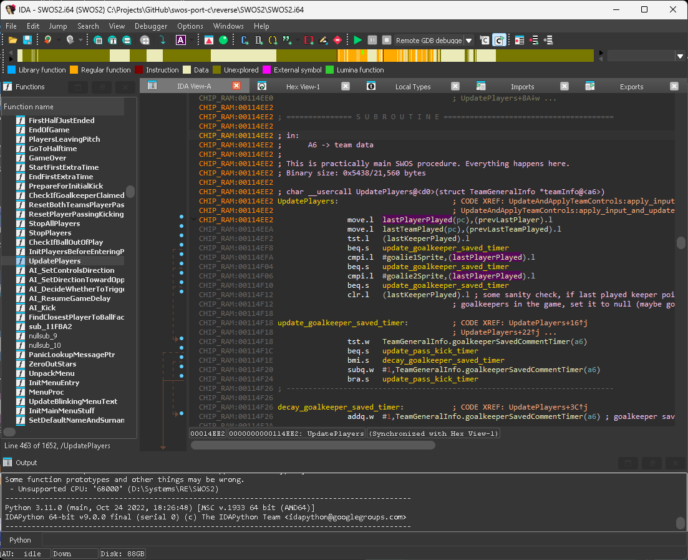

Main disassembly view in IDA Pro 9.0 showing the loaded SWOS Amiga binary.

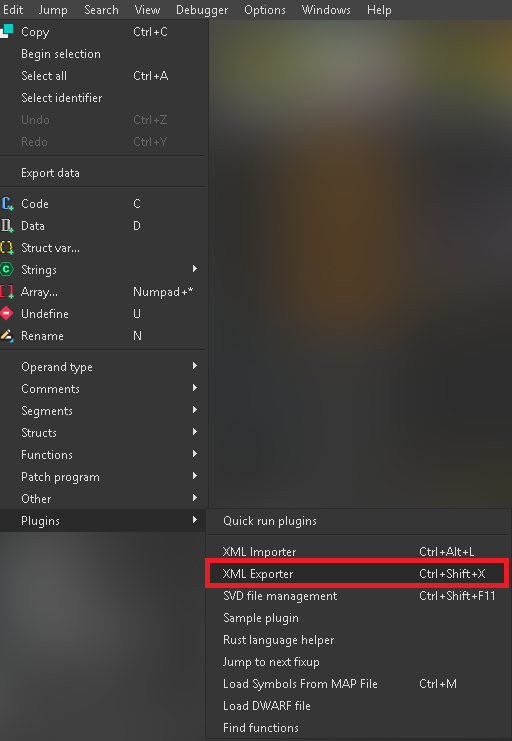

IDA Pro 9.0 menu showing how to access the XML Exporter plugin.

When you run the plugin you should see the following output:

```
XML Exporter v5.0.2 : SDK 900 : Python : Sep 24 2025 18:40:45

-----------------------------------------------------------
Exporting XML <PROGRAM> document ....
Processing PROGRAM                 CPU time: 0.2380
Processing DATATYPES               CPU time: 0.0946
Processing MEMORY_MAP              CPU time: 5.0945
Processing CODE                    CPU time: 2.4486
Processing DATA                    CPU time: 4.0267
Processing COMMENTS                CPU time: 8.8220
Processing SYMBOL_TABLE            CPU time: 3.4779
Processing FUNCTIONS               CPU time: 0.4861
Processing MARKUP                  CPU time: 1.2152
                             Total CPU time: 26.1107
--------------------------------------
PROGRAM                           1
INFO_SOURCE                       1
PROCESSOR                         1
COMPILER                          1
DATATYPES                         1
STRUCTURE                        26
MEMBER                          375
REPEATABLE_CMT                  379
UNION                             3
ENUM                             23
DISPLAY_SETTINGS                 23
ENUM_ENTRY                      532
MEMORY_MAP                        1
MEMORY_SECTION                    5
MEMORY_CONTENTS                   1
CODE                              1
CODE_BLOCK                      252
DATA                              1
DEFINED_DATA                  23325
TYPEINFO_CMT                   5732
COMMENTS                          1
COMMENT                       18209
SYMBOL_TABLE                      1
SYMBOL                         5920
FUNCTIONS                         1
FUNCTION                       1654
ADDRESS_RANGE                  1731
RETURN_TYPE                    1603
REGISTER_VAR                   1310
STACK_FRAME                      10
REGULAR_CMT                     352
MARKUP                            1
MEMORY_REFERENCE               2583
MANUAL_OPERAND                    1
EQUATE_REFERENCE                772
--------------------------------------
Total XML Elements:           64833
Database exported to: C:\Projects\GitHub\swos-port-c\reverse\SWOS2\SWOS2.xml
```

### Ghidra Setup

The `68000.cspec` file is a customized language file for Ghidra that marks all the 68000 registers as `unaffected`. Because SWOS is hand written assembly we should not assume registers will be clobbered in a uniform way such as those generated by a C compiler.

- Copy [68000.cspec](Ghidra/Processors/68000/data/languages/68000.cspec) to Ghidra's `Ghidra/Processors/68000/data/languages/` folder.

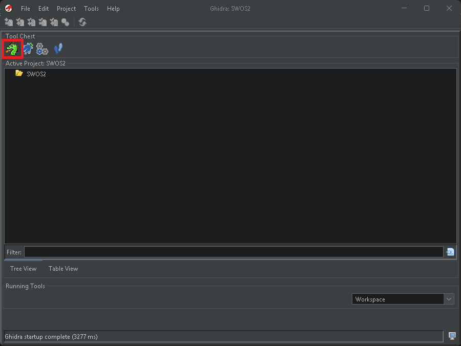

Ghidra project window open with the SWOS2 project loaded.

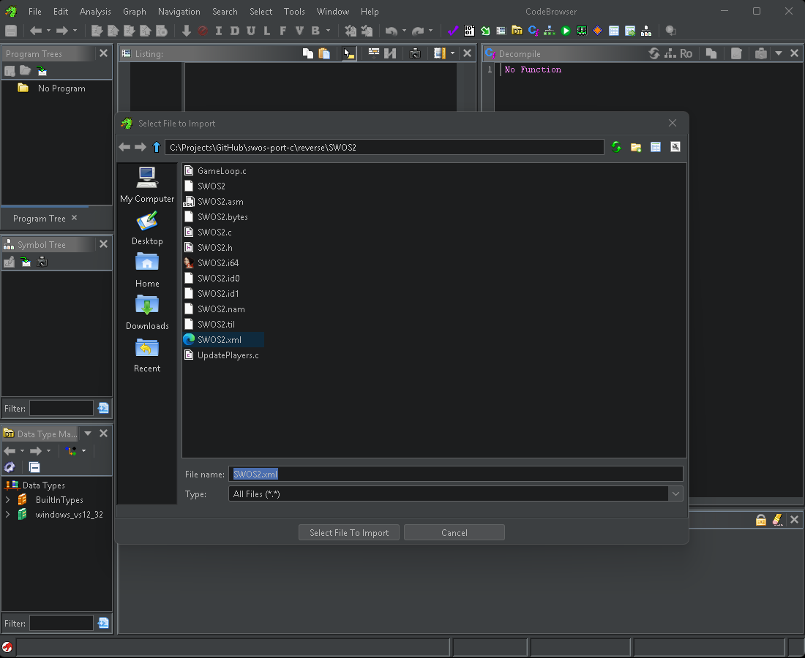

Selecting the SWOS2 XML export file for import into Ghidra.

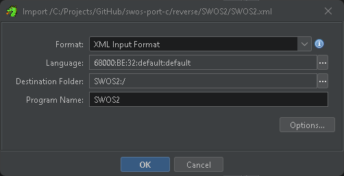

Ghidra import dialog.

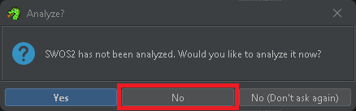

Prompt asking whether to run auto-analysis on the imported program.

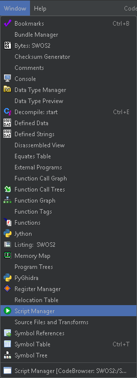

Opening the Script Manager from the Ghidra Window menu.

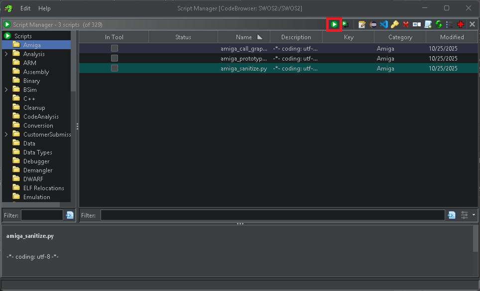

Custom Amiga-related scripts visible inside Ghidra's Script Manager. Select the `amiga_sanitize.py` script and click the `Run Script` button.

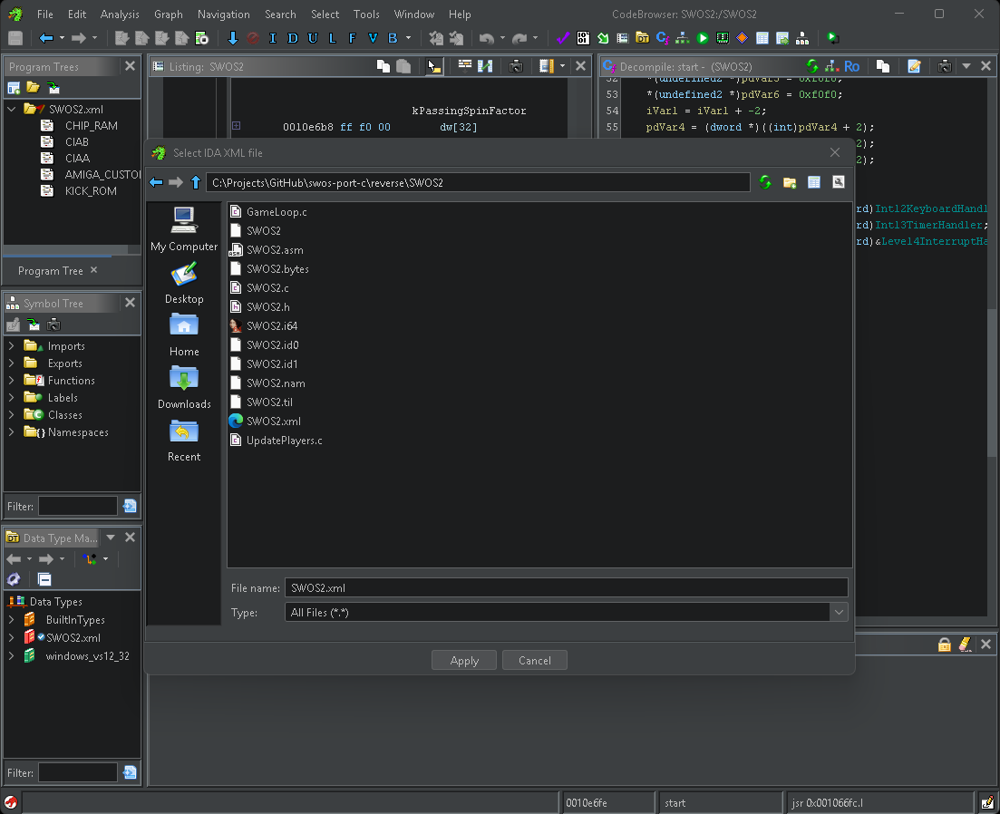

The script will prompt for the same SWOS2 XML file used on import.

```
amiga_sanitize.py> Running...
[IDA-XML->Ghidra] Functions updated: 1652, skipped: 0 (from SWOS2.xml)
[IDA-XML->Ghidra] DEFINED_DATA applied: 23027, skipped: 0.
amiga_sanitize.py> Finished!
```

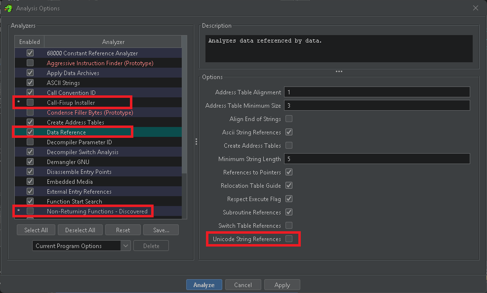

Ghidra's analysis options showing selected analyzers and settings. Set the following:

- Analysis Options
	- Call-Fixup Installer (Disabled)
	- Data Reference
		- Unicode String References (Disabled)
	- Non-Returning Functions - Discovered (Disabled)
- Edit > Tool Options > Decompiler > Analysis > Respect readonly flags (Enabled)

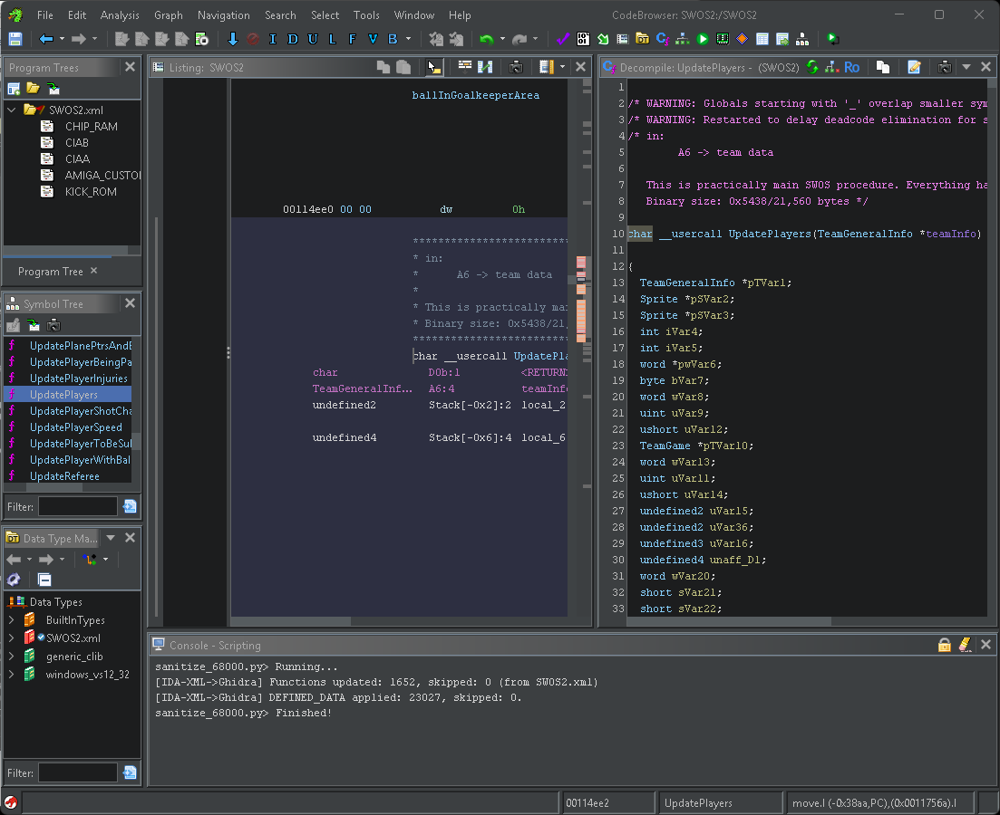

After analysis is complete the decompiled code should refresh.

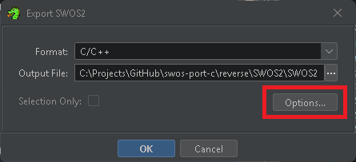

Select File > Export Program... and a dialog will appear. Select the `C/C++` format. Click the `Options...` button.

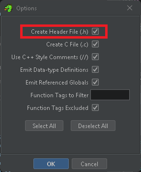

Put a tick next to the `Create Header File (.h)` option. Click `OK`, `OK` to output the `SWOS2.c` and `SWOS2.h` files.

### Ghidra Scripts

- Copy the scripts in [ghidra_scripts](Ghidra/ghidra_scripts) to `%HOMEPATH%/ghidra_scripts`

#### amiga_call_graph.py

`amiga_call_graph.py` is a Ghidra script that exports a _reachable call graph_ starting from the function currently under your cursor. It does a depth-first search over direct call sites (JSR/BSR/etc.), collecting every callee it can reach, optionally filtering out externals and thunks. The functions are then sorted by entry address and emitted to a single `StartFunctionName.c` file. The file begins with a banner and a clean list of C function prototypes synthesized from each function's return type, calling convention (if present), and parameters - so you get a quick, compilable-looking signature map of the slice of code you care about.

Optionally, it also decompiles each reached function with Ghidra's `DecompInterface` (Parameter ID enabled, "decompile" simplification) and appends the _raw_ decompiler output after the prototypes, labeling each block with the function name and entry address. Crucially, it writes the file in binary mode and preserves the decompiler's line endings verbatim to avoid mangling formatting. There's a toggle to re-run auto-analysis on the collected bodies (if your Ghidra build exposes `AutoAnalysisManager`), as well as configurable flags for including thunks/externals and a per-function decompile timeout. The save dialog lets you pick either a directory (it auto-names the file) or a specific filename (it adds `.c` if missing). In short: this script is a one-click way to harvest a coherent, address-ordered "mini-module" of prototypes plus (optionally) decompiled C for all functions reachable from a chosen entry point - perfect for staging focused refactors, code reviews, or AI-assisted cleanups.

#### amiga_prototypes.py

`amiga_prototypes.py` is a quick, one-shot exporter for **function prototypes** from your current Ghidra program. It walks every discovered function **in address order** (the binary's natural layout), formats a C-style prototype for each (return type, optional calling convention, name, and parameters), and writes them to a single **.txt** file you choose. Varargs are preserved (`...`), parameter names and types come from Ghidra's datatypes, and if anything is missing it falls back gracefully (e.g., to `int` or `param`). The result is a clean, linear list of signatures that's perfect for building headers, searching for API surfaces, or seeding decompiled modules with consistent declarations.

A couple of toggles let you trim noise: by default it **skips externals** (import stubs) and **thunks** (wrapper functions), but you can flip those flags if you want a complete picture. Under the hood it uses the FunctionManager's forward iterator to preserve address order, and a small helper normalizes type/parameter display names so the output stays readable. When it's done, it prints how many prototypes were written and where, giving you a simple, reproducible snapshot of the program's callable surface.

#### amiga_sanitize.py

`amiga_sanitize.py` is a two-pass **IDA-XML  to  Ghidra** importer that turns metadata from an IDA export into precise, compiler-like function signatures and correctly-typed MMIO data in your Amiga SWOS Ghidra project. **Pass 1 (FUNCTIONS)** reads each `<FUNCTION>` from the XML and applies an explicit `__usercall` signature with **custom register storage**: it maps every `<REGISTER_VAR>` to an actual 68k register via Ghidra's `VariableStorage`, sets the declared return type (and return register if given), carries over comments, and then **locks** the signature so later analysis won't undo it. The script also "sanitizes" types: it resolves built-ins and pointers, falls back to `unsigned int` or `void*` when a type can't be found, and avoids illegal `void` parameters. It normalizes register names (`d0.w`, `a1.l` to `d0`, `a1`) and wraps all updates in transactions for safety.

**Pass 2 (DEFINED\_DATA / MMIO)** walks `<DEFINED_DATA>` nodes to define hardware registers as **volatile** scalars at their exact addresses, attaching the label from `TYPEINFO_CMT`. It enforces Amiga-specific rules: **CIA ranges** (`BFDxxx`/`BFExxx`) are forced to **8-bit** types (e.g., `uchar`) while **Custom chip** (`DFFxxx`) keeps the XML's width (typically `ushort`). The helper carefully **reuses existing exact data** when it matches, or **surgically clears** only the necessary byte range to create the right unit - avoiding unnecessary bulldozing of larger containers. Overall, the script upgrades a raw IDA XML dump into Ghidra with realistic calling conventions, register-accurate prototypes, and correctly-typed volatile MMIO, giving you cleaner decompilation and fewer false "unknown/undefined" artifacts downstream.

## GameLoop and UpdatePlayers

[GameLoop.c](SWOS2/GameLoop.c) is the outer, per-frame orchestrator: it advances global timers/state machines and gates when real play can proceed. In this code snippet, the work is centered in `UpdateGameTimersAndCameraBreakMode()`. It increments the in-game/stoppage counters, handles penalty progression, and drives game-state transitions (kick-off, half-time, full-time, extra time, showers/results screens). It also runs the whole "camera break" pipeline (the `breakCameraMode` 0 to 7/8 ladder) that freezes play, positions the ball, triggers replays/highlights, waits for players/keeper states to settle, then re-arms the match. Along the way it primes or suppresses inputs depending on menus/substitutions and special states (e.g., `ST_KEEPER_HOLDS_BALL`). In other words, GameLoop.c is the authority on _when_ football can actually happen and _what phase_ of the match we're in.

[UpdatePlayers.c](SWOS2/UpdatePlayers.c) is the core simulation loop - the "everything happens here" routine that executes the football itself once the outer loop says go. You see it being driven from `UpdateAndApplyTeamControls()`, which interprets input for _one team per frame_ (alternating teams across frames), computes directional intent and fire/quick-fire/normal-fire edges from the button counters, applies menu/substitution gating, and then calls `UpdatePlayers(team)` to realize movement, tackles/headers, animation table switches, ball interactions, and per-sprite state updates. That same `UpdatePlayers(...)` can also be hit from inside `UpdateGameTimersAndCameraBreakMode()` during panic/recovery paths (e.g., after a break sequence) to keep the simulation coherent. Practically, this means **GameLoop.c controls the cadence and high-level state of the match**, while **UpdatePlayers.c performs the per-frame physics/AI/control application**. They're tightly coupled: `UpdateGameTimersAndCameraBreakMode()` is invoked first to ensure the world is in a legal state, and `UpdateAndApplyTeamControls()` (which calls `UpdatePlayers` twice per frame across the two teams) applies the inputs and updates the on-pitch actors. This layering is why both files are pivotal: one keeps the match rules, timers, and presentation consistent; the other actually plays the football.

## Amiga Assembly

### VSCode

[export_sparse_asm.py](IDAPro/Scripts/export_sparse_asm.py) 

Install the [Amiga Assembly](https://marketplace.visualstudio.com/items?itemName=prb28.amiga-assembly) VSCode Extension and open the project located in the `reverse/Amiga/SWOS` folder. The [export_sparse_asm.py](IDAPro/Scripts/export_sparse_asm.py) script generates the assembly file [SWOS2.s](/reverse/Amiga/SWOS/SWOS2.s) which can be assembled to create a 1:1 binary of the original.

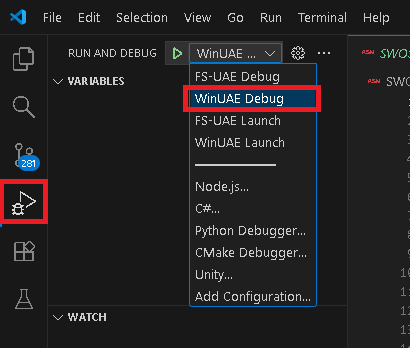

#### Copy the Kickstart ROMs

After you install the extension you'll need to copy the `Kickstart v3.1 rev 40.68 (1993)(Commodore)(A1200).rom` into the following locations:

- Windows
    - WinUAE: `%HomeDrive%%HomePath%\.vscode\extensions\prb28.amiga-assembly-1.8.13\dist\bin\winuae\Kickstarts`
    - FS-UAE: `%HomeDrive%%HomePath%\FS-UAE\Kickstarts`

Unfortunately I can't get FS-UAE to work as I get a `Exception "Stackframe Format Error" ($38) at $939A20 (ExpMem $83A20) occurred.` but WinUAE does launch.

#### Run WinUAE

Set your VSCode debugger to `WinUAE Debug`.

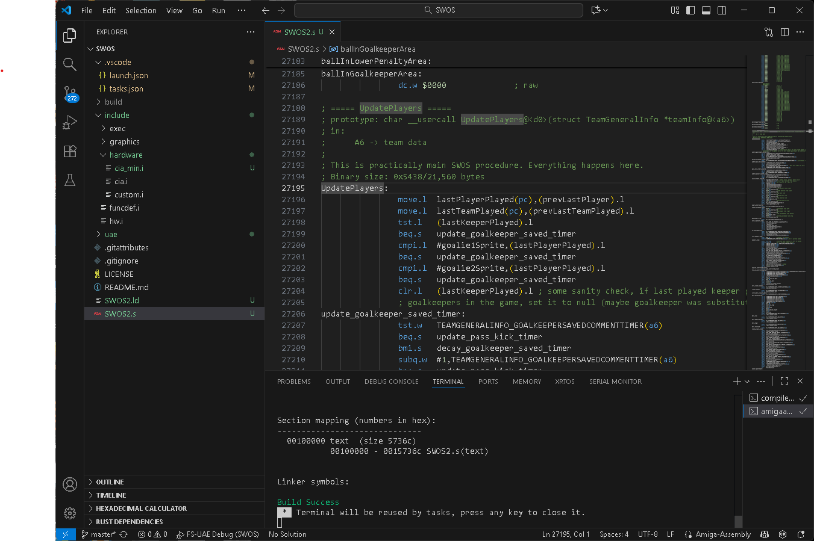

Click the `Start Debugging` (`F5`) to launch WinUAE and you should see SWOS running.

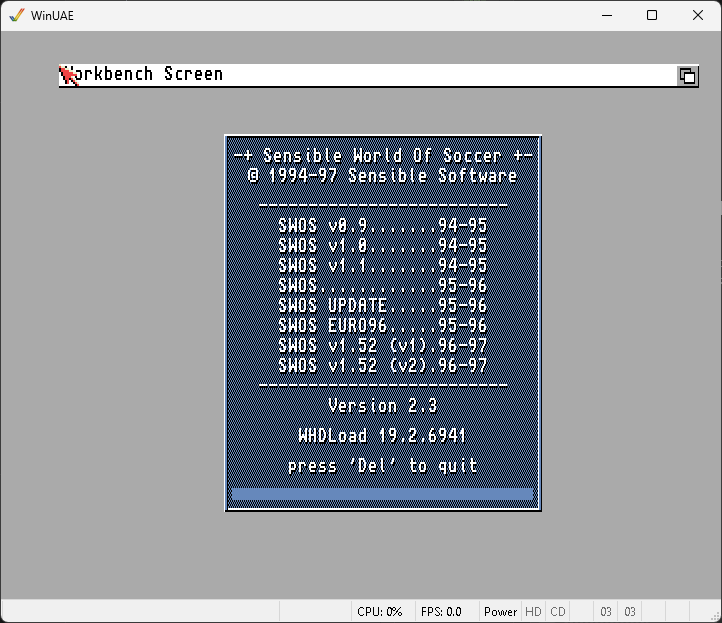

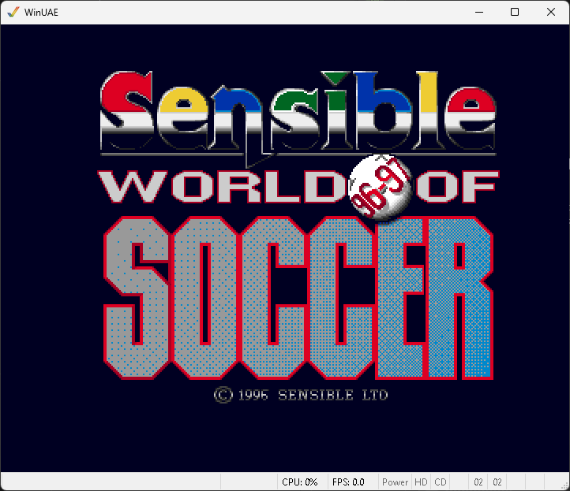

#### WinUAE Hotkeys

- **Pause/Resume emulation:** `Pause/Break`
- **Toggle fast-forward (warp):** `End` + `Pause/Break` (press again to go back)
- **Toggle fullscreen:** `Ctrl`+`F12`
- **Quit:** `Alt`+`F4`
- **Settings:** `F12` opens the WinUAE settings dialog

#### WinUAE Debugger

- `h` command                                      Show detailed help for command
- UAE Console:
    Use a `$` prefix to execute commands in the emulator's built-in console debugger
    e.g: `$v -3`    Enable visual debugger
         `$?`       Show help
- Expressions:
    Expressions use JavaScript-like syntax and can include literals, symbols, registers and memory values.
    They can be evaluated in the console as well as in command args, watch, conditional breakpoints and logpoints.
    Type 'h expressions' for more details.
    `@(address[,size=4])`                            Unsigned memory value
    `@s(address[,size=4])`                           Signed memory value

### DevPac on Amiga

You can download [Devpac 3.14](https://archive.org/details/Devpac_v3.14_1994-12-16_HiSoft) and assemble [SWOS2.s](/reverse/Amiga/SWOS/SWOS2.s) from Workbench! It's not really worth the effort to cover this but it's pretty cool! Fortunately for us `vasm` supports assembling m68k with the `-devpac` parameter to produce the same binary. So we can get a 1:1 binary of the original using VSCode instead of using an Amiga or emulator.

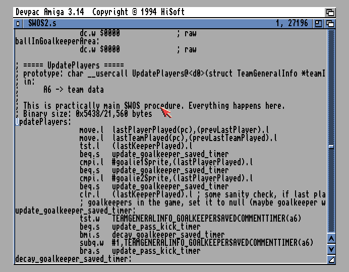

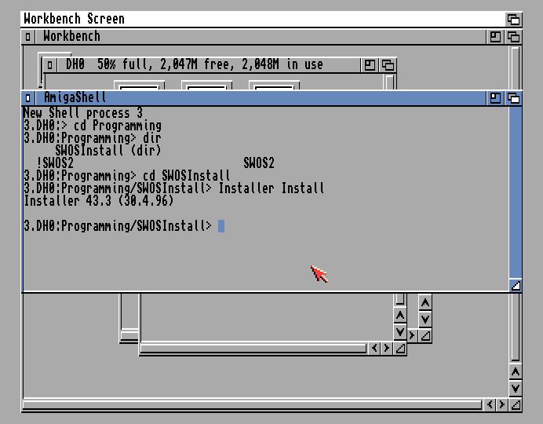

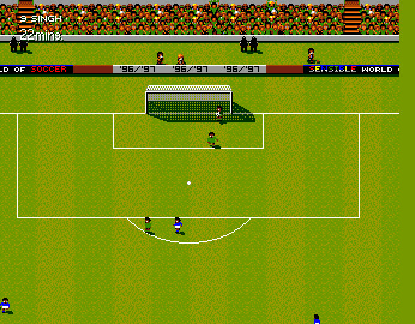


### WHDLoad

The WHDLoad SWOS.Slave has the following patches:

- **Fixes major long-standing bugs & crashes**
	- Fixes a crash when changing/loading tactics (issue #0006185).
	- Reworks load/save logic so tactics can be properly saved and loaded again.
	- Adds a workaround for random access faults when selecting teams (not fully systematic, but reduced).
	- Removes several old low-level problems (memory bus errors, divide-by-zero, CACR code, snoop bugs on most versions).
- **Improves performance and memory usage on real hardware**
	- Makes the game use **fast RAM** instead of only chip RAM, removing the infamous long-time slowdown on accelerated Amigas.
	- Adjusts memory requirements to **1 MB Chip + ~2.5 MB other (Fast) RAM**, and fixes the config so it runs properly on 68000–68060 systems.
- **Cleans up file layout & saves**
	- Game now looks for data files in a `data` directory (matching how the installer copies them).
	- User data (seasons, leagues, careers, highlights, tactics, DIY, etc.) is saved/loaded from a `SAVE` directory.
	- Allows loading **larger team files** (`team.xxx`) without having to RNC-pack them (with some remaining size limits).
- **Quality-of-life & WHDLoad integration**
	- Full load from hard drive (“real files”, no virtual disk images).
	- Quit key added (Del / WHDLoad quit support, including on 68000 in most versions).
	- Provides icons (RomIcon, NewIcon, GlowIcon) and standard WHDLoad tooltype hints (NOCACHE, PAL/NTSC, etc.).
- **Known original-game bug that remains**
	- The old SWOS quirk is still there: if you try to watch a **highlight** without having played a match since loading, the game can hang. You still need to play at least a moment of a match before watching highlights.

The [SWOS.Slave](reverse/Amiga/SWOS.Slave) project contains the [SWOSHD.s](/reverse/Amiga/SWOS.Slave/SWOSHD.s) which will assemble to `SWOS.Slave`.

You will need to download the [NDK3.2R4.lha](https://www.hyperion-entertainment.com/index.php/downloads) and extract it using a tool like 7-Zip and create an environment variable called `AMIGA_NDK` that contains the directory to it (Eg. `C:/Projects/Amiga/NDK3.2R4`). Make sure you have the [Amiga Assembly](https://marketplace.visualstudio.com/items?itemName=prb28.amiga-assembly) VSCode Extension installed as it uses its `vasmm68k_mot` as the assembler.

#### `startup-sequence`

```
C:WHDLoad SLAVE=DH0:SWOS.Slave DATA=DH0:data PRELOAD PreloadSize=2051816
; Quits the emulator at the end of the program
C:UAEquit
```

### What is SWOS.Slave?

`SWOS.Slave` is a **WHDLoad slave** is a tiny loader/patcher that makes an original game run cleanly from hard drive under WHDLoad (instead of from floppies). In practice, the slave:

- **Declares runtime requirements** (chip/fast memory, version, flags) via the WHDLoad slave header, and exposes a quit key.
- **Loads and relocates the game binary** (e.g., `SWOS2` plus its relocation table), placing code/data into the configured ExpMem/ChipMem.
- **Applies patches at startup** (via a patch list) to fix compatibility/snoop issues, skip copy-protection, adjust blitter/timing, and route file I/O.
- **Bridges file access** (save/load) to WHDLoad’s “resload” API so saves go to a folder (e.g., `SAVE/`) instead of disks.
- **Handles WHDLoad tooltypes** like `PRELOAD`, `NOCACHE`, `NOVBRMOVE`, etc., and cooperates with options like `whdload_quit`.
- **Installs small hooks** (e.g., keyboard exit) and cleanup paths, then jumps into the game’s entry point.

### Hdf Version

The SWOS2 binary is a 1:1 match of the WHDLoad version.

The Hdf binary contains the following patches:

Patches:

- SWOS HDF boots directly into the game (no quit key etc.)
- Game fully loaded from hard drive
- Save files are saved to floppy drive

#### `startup-sequence`

```
ssboot SWOS
```

### SWOS-HD

The [SWOS-HD](https://eab.abime.net/attachment.php?attachmentid=39249&d=1393875843) version developed for AIAB (Amiga In A Box) by Galahad of Fairlight uses [jst](https://github.com/jotd666/jst) to boot a WHDLoad slave file.

Features are the same as the WHDLoad version.

#### `startup-sequence`

```
jst swos.slave PRELOAD >nil:
reset
```

### Patches

There are various versions of ASWOS in the `SWOS dev` team have produced. So I've created a bunch of patch files using `diff` to show what those changes are from the original TOSEC release version.

Currently the only change is to remove the size check and automatically launch `swos_152` version.

- [SWOS2.patch](bin/2425/SWOS2.patch) (24/25) this patch for the Amiga version of Sensible World of Soccer applies the SWOS 24/25 season database to the original SWOS 96/97 executable and data files. It updates player, team, and national squad data worldwide to reflect the 2024/25 season while intentionally preserving the original Amiga league structures and division layouts for most countries (including major European and several American leagues), even where these no longer match the real-world 24/25 formats. Structural changes and expanded league formats that exist in some PC-only edits are not included in this Amiga patch; only the underlying database entries (teams, squads, and related metadata) are refreshed. The patch also incorporates specific Amiga-targeted adjustments for selected regions (e.g., revised Oceania setups) and an updated national-team pool, but it does not alter core game code, executable logic, or gameplay systems beyond these data-level modifications
- [SWOS2.patch](bin/ASWOS/SWOS2.patch) (ASWOS) enables Player 2 on Port 0 (Mouse port) to be able to move around in the menus when game starts 
- [SWOS2.patch](bin/Segra/SWOS2.patch) (Segra) early patched version with change from Yugoslavia to Serbia, cup changes to Euro Cup, Cup Winners, UEFA Cup and World Cup Qualifying Group data and Belarussia, English, Greek, Scottish, Slovakian, Slovenian, Bolivian, Brasilian and Chilean league data
- [SWOS2.patch](bin/HD/SWOS2.patch) (HD) the patches contained are interesting but unknown as to what they do at this stage
- [SWOS2.patch](bin/WHDLoad/SWOS2.patch) (WHDLoad) [README.md](bin/WHDLoad/README.md)

To get a full `SWOS2.s` of the patch you can copy the unpatched `SWOS2.s` into the folder and apply the patch like so:

```sh
$ git apply SWOS2.patch
```

#### Viewing Patch Diffs

Once you've created a full source patch of `SWOS2.s` you can now use VS Code to compare them and view the patches side by side with the original source.

1. Right-click on the original `SWOS2.s` file and select `Select for Compare`

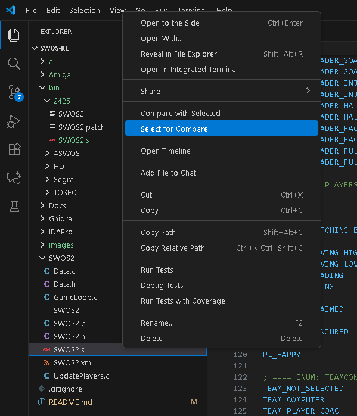

2. Right-click on the newly created `SWOS2.s` file and select `Compare with Selected`

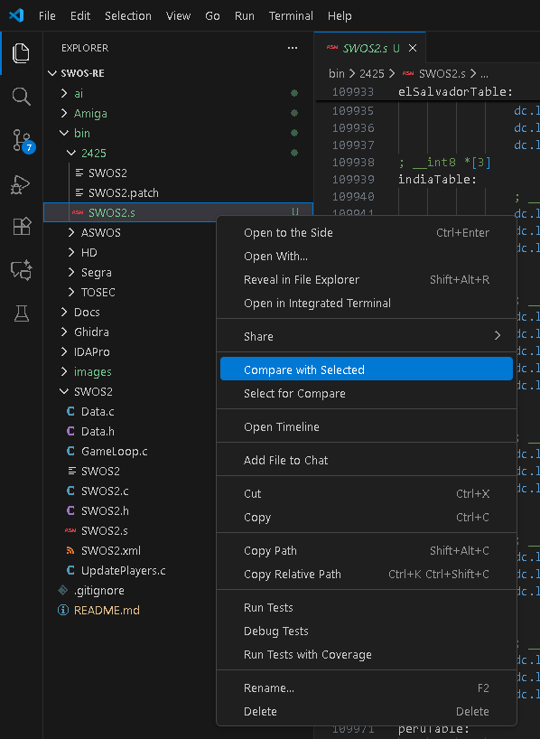

3. It will open a side by side view of both files with some navigation buttons.

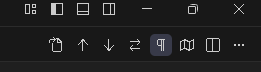

4. Click on the down arrow to view the various patches within the assembly.

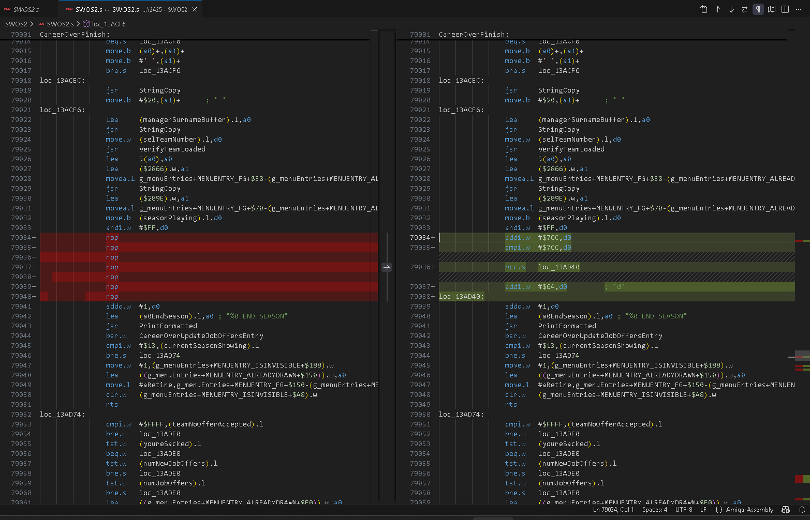

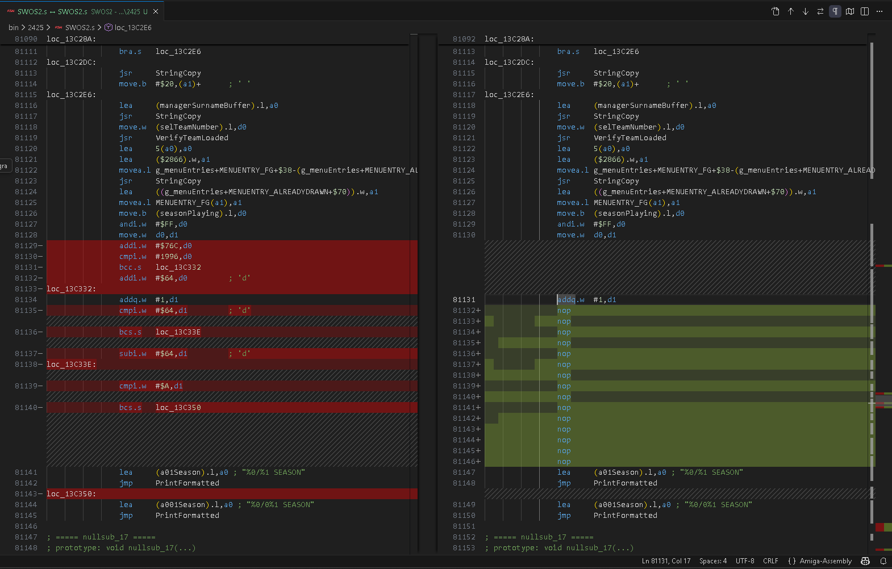

## Amiga C

- [Amiga C/C++ Compile, Debug & Profile](https://marketplace.visualstudio.com/items?itemName=BartmanAbyss.amiga-debug) VSCode Extension.

## AI Assistance

Coming Soon!

- ChatGPT
    - [Amiga Guru](https://chatgpt.com/g/g-v6L6s1ktd-amiga-guru)

- MCP Servers
	- https://github.com/LaurieWired/GhidraMCP
	- https://github.com/jtang613/GhidrAssistMCP
	- https://github.com/mrexodia/ida-pro-mcp

## Credits

- [benbaker76](https://github.com/benbaker76/) - SWOS Amiga RE Project Lead/Developer
- [Playaveli](https://github.com/Playaveli) - SWOS 2020 Project Manager
- [segra](https://github.com/segrax) - SWOS Amiga RE Project Founder
- [starwindz](https://github.com/starwindz/) - SWOS 2020 PC Lead/Developer
- [zlatkok](https://github.com/zlatkok) - SWOS DOS RE Project Lead
